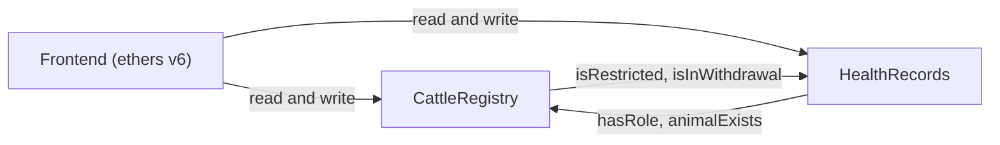
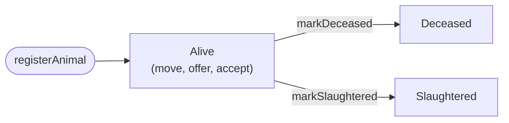

# HerdLedger
A Web3 cattle provenance system on Ethereum. A farmer registers an animal under its ear tag, and from then its farm movements, ownership changes, and vet health records live in a tamper evident history that anyone can read.

## What it does
 
- **Registers animals** by unique ear tag, owned by the farmer who registered them.
- **Transfers ownership in two steps:** The owner offers, the recipient accepts and records where the animal is now. Nobody can be handed an animal they did not agree to take.
- **Keeps an append-only movement history** with timestamps and who recorded each move.
- **Records vet-attested health data** (vaccination, treatment, test, inspection). Supporting documents stay off-chain; only their hash is anchored.
- **Enforces medicine withdrawal periods:** An animal inside a withdrawal period cannot be recorded as slaughtered until it passes.
- **Restricts movement after an adverse test:** A restricted animal can only be sent to a processor until a vet lifts the restriction.
- **Ends each animal's life explicitly** as deceased or slaughtered, after which its record is closed.
  
## How it works
 

 
The two contracts check each other through small interfaces. `HealthRecords` reads roles and animal existence from the registry, so permissions live in one place. The registry asks `HealthRecords` whether an animal is restricted or in withdrawal before it allows a move, a transfer to a farmer, or slaughter.
 

 
### Roles
 
Roles use OpenZeppelin `AccessControl` and live in the registry. The deployer is the admin and grants the rest.
 
| Role | Can do |
|---|---|
| Farmer | Register animals, record movements, offer and accept transfers |
| Vet | Add health records, place or lift restrictions, record a death |
| Processor | Receive animals and record slaughter (only if it owns the animal and no withdrawal is running) |
| Admin | Grant or revoke roles, set the guard contract, pause or unpause the registry |
 
### Rules enforced on-chain
 
- An ear tag can be registered once. Tags are stored as a keccak256 hash and emitted in full in an event.
- A transfer recipient must hold the farmer or processor role at both offer and accept time.
- A withdrawal period (up to 365 days) is set by a treatment or vaccination. The latest end date wins.
- An adverse test result restricts the animal automatically.
- Deceased and slaughtered animals cannot move, transfer or change.
- The admin can pause all state-changing registry calls.
  
## Getting started
 
Requires Node.js 18 or later.
 
```bash
git clone https://github.com/<your-username>/herd-ledger.git
cd herd-ledger
npm install
npm test
```
 
Run it locally in three terminals:
 
```bash
npm run node             # 1: local chain (chain ID 31337)
npm run deploy:local     # 2: deploys, seeds demo data, writes frontend/deployment.json
npm run serve            # 3: frontend at http://localhost:5173
```
 
To act as a farmer, vet or processor in the browser, add the local network to MetaMask (RPC `http://127.0.0.1:8545`, chain id 31337) and import one of the Hardhat test accounts that `deploy:local` prints. Those keys are public, so never send real funds to them.
 
Demo animals after seeding:
 
| Tag | State |
|---|---|
| `IE123456780001` | Treated, inside a withdrawal period, three movements |
| `IE123456780002` | Offered to another farmer, not yet accepted |
| `IE123456780003` | Restricted after an adverse test |
 
If your network blocks the Solidity compiler download, set `SOLCJS=1` before any Hardhat command to compile with the bundled `solc` package instead.
 
## Deploying to Sepolia
 
1. Create a **throwaway** wallet and get Sepolia test ETH from a faucet.
2. Copy `.env.example` to `.env` and fill in `SEPOLIA_RPC_URL` and `DEPLOYER_PRIVATE_KEY`. Optionally set `FARMERS`, `VETS` and `PROCESSORS` (comma-separated addresses) to grant roles at deploy time, and `ETHERSCAN_API_KEY` to verify the contracts.
3. Run `npm run deploy:sepolia`. It deploys both contracts, wires them together and writes `frontend/deployment.json`.
4. Commit `frontend/deployment.json` and host `frontend/` on any static host.
| Contract | Sepolia address |
|---|---|
| CattleRegistry | `<add after deploying>` |
| HealthRecords | `<add after deploying>` |
 
Live demo: `<add link after hosting>`
 
Deploying both contracts costs roughly 3 million gas. That is free on Sepolia, around 0.03 ETH on mainnet at 10 gwei, and cents on an L2 such as Base or Arbitrum. Run `npm run test:gas` for a per-function gas table.
 
## Testing
 
| Command | Covers |
|---|---|
| `npm test` | 43 contract tests: access control, validation, transfers, life-cycle, pause, withdrawal, restrictions, end to end |
| `node scripts/smoke-frontend.mjs` | Frontend data layer against a seeded local chain |
| `node scripts/ui-test.mjs` | The real UI code run headlessly against a seeded local chain, including wallet connect, transactions, error messages and HTML escaping |
 
The last two need `npm run node` and `npm run deploy:local` running first.
 
## Design decisions
 
- **Hashed tags, full tags in events.** Comparing a 32-byte hash is cheap. Storing a string costs far more gas than emitting it, and the frontend recovers the original tag from the event log.
- **Two-step transfers.** An immediate `transfer(to)` would let anyone dump an animal, and any restriction on it, onto someone who never agreed.
- **A guard interface instead of direct imports.** The registry depends on a two-function interface, not on `HealthRecords`, which avoids a circular dependency and lets the guard be swapped or removed.
- **One source of truth for roles.** `HealthRecords` reads roles from the registry, so granting or revoking a vet takes effect everywhere at once.
- **Paginated history getters.** A history only grows, so a function that returns all of it would eventually exceed the gas limit for reads.
- **Only hashes of documents on-chain.** Lab results and certificates stay off-chain, which keeps costs and exposure down.
- **Custom errors and packed structs** keep gas costs low.
  
## Limitations
 
- **A chain cannot verify the physical animal.** Anyone with the farmer role can register a tag. The registry proves who recorded what and when, not that the tag was on the right animal.
- **Everything is public.** Owner addresses, locations and health notes are readable by anyone.
- This models an idea. The real Irish system is the Department of Agriculture's AIM database.
  
## Project structure
 
```
contracts/       CattleRegistry.sol, HealthRecords.sol, interfaces/
test/            Hardhat tests and shared fixtures
scripts/         deploy.js (with local seeding), frontend data and UI tests
frontend/        index.html, styles.css, app.js, lib.js, deployment.json
```
 
## License
 
MIT. See [LICENSE](LICENSE).
